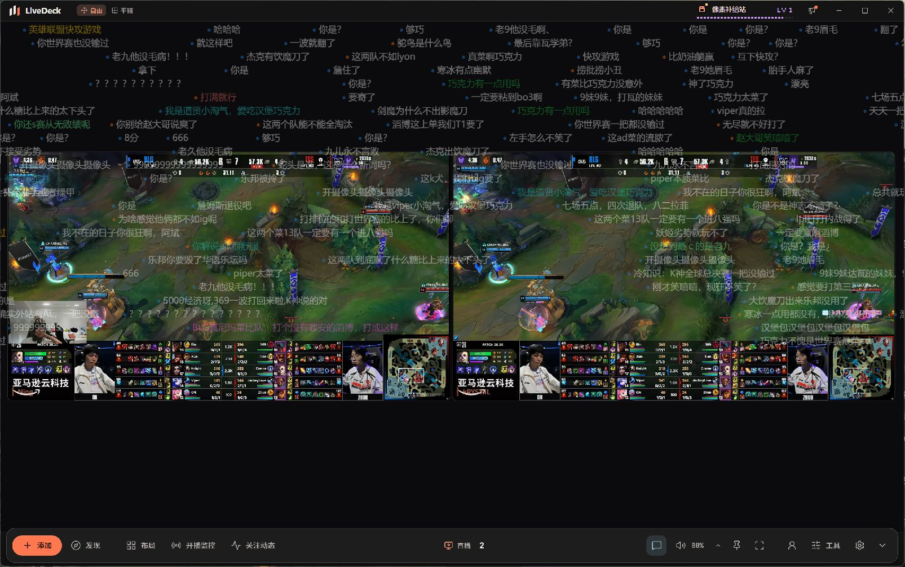
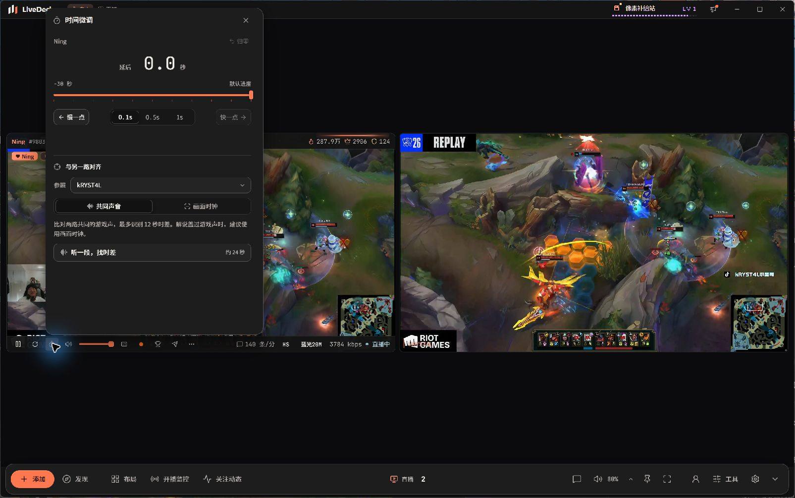

# LiveDeck

> 多路直播同时观看的桌面工作台

LiveDeck 让你在一块屏幕上同时看多个斗鱼、虎牙与哔哩哔哩直播间，不同平台的房间可以混排在同一个布局里。可以用星幕自动编排、聚焦比赛视角，也可以像在 OBS 里摆场景一样自由拖动缩放。所有房间的弹幕汇进同一个引擎全屏滚动，不必再挤在每个小窗口自己的弹幕栏里。

适合同时追多个主播、看比赛多视角、或者一边玩游戏一边挂着直播的场景。

1.4.0 新增星幕布局、实时字幕翻译、画面与声音增强，以及 B 站视频搜索、虎牙赛事和更完整的鱼吧阅读。完整变化与旧版操作调整见 [更新历史](CHANGELOG.md)。

1.3.0 历史界面参考

以下为 1.3.0 的界面截图，控制台入口与布局选择以当前版本为准。

## 功能特性

### 多窗口与布局

- **任意数量的直播窗口**，每个窗口独立控制音量、清晰度、线路与弹幕开关
- **三种布局模式**，`Alt+T` 按星幕、自由、平铺循环切换：
  - **星幕布局**：自动编排多路画面，可同时聚焦多个视角、拖拽交换、固定格位和调整重点区比例；按住 `Z` 临时放大，滚轮巡看，按住 `A` 临时独听。首次使用默认星幕，已有布局继续恢复保存的模式
  - **自由布局**：像 OBS 一样任意摆放，八向缩放，边缘与窗口间自动吸附并显示参考线，按住 `Alt` 临时禁用吸附
  - **平铺布局**：窗格铺满舞台无缝拼接，拖动分隔线调整比例，可切分、交换、临时全屏
- **快速版式**：自由和平铺布局提供均分网格、主副（右栏 / 下栏）、画中画；星幕提供构图预览，确认后应用
- **撤销与重做**：布局操作都可撤销，误关窗口也能找回
- **布局方案存储**，命名保存多套布局随时切换，适配不同观看场景，支持导出导入
- **观看组**：把一组直播间命名保存，一键整组打开
- **占位区**：用占位区占住游戏窗口的位置，方便单屏用户一边玩游戏一边看直播，占位区参与布局但不播放内容
- 窗口支持锁定防误拖、多选与框选；自由布局下可置顶置底调整叠放次序

### 直播播放

- **发现直播**：按平台浏览分类、搜索主播，从关注与最近访问里直接挑房间开窗
- **快速添加**：从标题栏或 `Ctrl+K` 打开，连续选择监控主播，或按主播名、房间号和链接查找新来源；已打开的来源可直接定位。发现页记住平台、内容类型、栏目与开播筛选
- **三平台直播**：斗鱼、虎牙、哔哩哔哩，输入房间号、链接或分享文本自动识别平台并取流，HLS / FLV 自动适配，**默认最高清晰度**
- **自由切换清晰度与线路**，遇到某条线路卡顿可以换一条
- **直播时间微调与多路对齐**：调整 0–30 秒附加延迟，借助共同声音或画面时钟对齐同场比赛的不同视角；画面与声音一起调整，弹幕保持实时
- **兼容回放模式**，支持回放的直播间可用进度条拖动观看
- **回看弹幕补全**：回看时自动接入斗鱼官方弹幕归档，应用没开着的时段也有弹幕
- 取流失败、地址过期、画面停滞均自动重试，退避上限 5 秒且不限次数
- **丰富的房间信息**：标题、主播昵称与等级、热度、贵宾数、福星挑战赛区、清晰度、码率、弹幕速率，以及房间各类排行榜
- **音频独听（SOLO）**：一键只听某个房间，其余全部静音；普通模式下也可单独开关任意房间声音
- **多路响度平衡**：在「音量与混音」开启，校准各路常态音量，减少不同主播的音量落差；支持逐路微调与重新校准，保留节目原有的强弱变化
- **音频增强 BETA**：播放器「更多控制 → 音频增强」提供对白增强、背景降噪、夜间模式与原声对比；设置页有访谈、游戏直播和音乐预设。处理在本机完成，不使用麦克风
- **画面增强 BETA**：播放器「更多控制」提供插帧与超分，参数和显卡组件集中在「设置 → 画面增强」。插帧可选 NVIDIA VFX、AMD AMF 或通用 GPU；VFX 与通用 GPU 提供 2／4／8 倍及指定帧率，AMD 仅支持 2 倍。超分可单独使用或与两倍插帧组合，同时最多一路；HDR、倍速与系统画中画保留原视频。8 倍为实验性选项，最高 480 fps 是配置目标，实际表现取决于设备与内容
- **实时字幕与翻译 BETA**：直播与视频可显示原文、译文或双语，可优先翻译已有字幕并调整字幕样式。每次最多一路；本地模式在本机识别语音、翻译时发送字幕文字，Echo 在线模式上传播放器音频。详见 [字幕模式与数据使用](docs/faq.md#实时字幕有哪些模式会上传什么)
- **录像与视频**：浏览斗鱼、虎牙录像及 B 站主播已公开的直播回放，也可打开 B 站视频（含分 P），与直播并排观看；录像页可快速选择在看的主播
- **B 站视频搜索**：从「发现 → B 站 → 视频」按关键词搜索，按综合、最多播放或最新发布排序，直接将视频加入布局
- **斗鱼团播活动**：从「发现 → 斗鱼 → 直播 → 团播活动」查找活动成员，可添加窗口或快速切换主播
- **虎牙赛事与高画质**：直播目录的「赛事直播」提供官方赛程、主直播与二路；支持上游有效的选手 POV、已获授权的直播回看，以及当前身份和设备可用的 HEVC、HDR、高分辨率画质。HDR 需要相应显示输出与解码能力，各项入口以平台实际开放为准
- **PK 与连麦**（斗鱼）：底部比分条实时显示双方比分、连麦成员，可一键打开对方房间
- **播放调试面板**：右键窗口打开，查看下载速率、缓冲与帧率曲线，可复制脱敏报告用于反馈

### 弹幕

- **全局弹幕模式**：融合显示所有已开窗直播间的弹幕，以弹幕前的**颜色指示点**区分来源房间 —— 解决多窗口时每个窗口弹幕区太窄的问题
- **高性能渲染**：可选 WebGL 纹理批渲染模式，同屏上万条弹幕仍保持稳定高帧率（实际取决于显卡）；WebGL 不可用时自动回退到兼容模式
- 还原弹幕颜色、用户等级、粉丝牌与表情，轨道自动防重叠，超载限流
- **弹幕消息卡**：按住 `Alt` 单击弹幕，查看发言者头像与资料，可引用或 +1
- **本人弹幕标记**：自己的发言显示专属标记与下划线；斗鱼神秘人使用独立样式，消息卡保留匿名身份
- **消息与事件时间线**：按时间回溯各房间的弹幕、礼物、进场等事件
- **特别关注**：按平台账号（UID）或昵称关注特定用户，其进房、发言、送礼会突出显示，并可设置绕过全部过滤规则；关注动态记录这些用户的行为，统计表支持搜索、排序与筛选
- **屏蔽策略**：关键词 / 正则、昵称、UID、最低用户等级（按平台分别设置）、最大弹幕长度
- **其他房间事件**：礼物、高能弹幕、进场、开通会员，按平台分别设置开关；高能弹幕、上头条与 SC 可设置金额门槛，默认精简展示，也可选择跟随平台时长
- **逐窗弹幕开关**：单个窗口可单独关闭弹幕显示。关闭只停止渲染，**不断开连接** ——事件提醒、关注用户通知、房间榜单与弹幕速率统计照常工作

### 斗鱼鱼吧

- **浏览鱼吧**：从控制台的「工具」打开，自动从当前房间发现主播鱼吧，也可直接输入鱼吧 ID 或地址；支持随看与展开阅读、应用内话题页、热门推荐和近 7 天热度排行榜。未登录可匿名浏览动态、精华、相册、视频、主播动态及评论回复，图片与视频在应用内查看
- **鱼吧互动与个人内容**（需登录）：签到、发动态、评论、回帖、点赞、表态与收藏，查看已加入鱼吧、关注动态、收藏及赞过的内容。应用不会自动加入任何鱼吧，发帖等操作由服务端按加入状态与等级门槛校验

### 像素补给站

- 新手教学、日常任务、每周邀约与长线成就，跟着任务就能摸清各项功能
- 像素营地与任务界面更新，指南涵盖字幕、画面增强、声音增强等功能
- 金币与经验只记录在本机，按真实观看与操作推进，不需要登录

### 开播监控与导演模式

- **开播监控**：把主播加入监控列表，**开播与下播时分别通过系统通知提醒**（两个开关独立），点击开播通知可直接开窗。托盘菜单显示当前在播数量
- 开播监控与关注动态面板可以左右切换或收为小卡，打开面板时保持观看窗口的位置与播放
- **智能导演模式**：自动以高亮边框突出当前热度快速上涨的直播间，免得错过精彩时刻。评分权重（弹幕速率、贵宾数、热度、礼物）可自由配置，也可整体关闭。轮播与未开播的房间不参与判定，避免"有人在等"被误判成精彩

### 界面与设置

- **墨黑与瓷白主题**，舞台背景色可选预设或自定义
- **OLED 防烧屏**：可在「设置 → 外观与舞台」开启画面微移、闲置调暗与视频静态亮区调暗；不能保证避免烧屏，原生画中画不受保护
- 控制台从标题栏打开，也可按反引号／波浪键开合；应用全屏时将鼠标移到右上角唤出入口，移动鼠标可显示顶部退出入口
- 标题栏声音按钮支持快捷静音，悬停可调节总音量，并打开完整混音面板
- 有直播窗口时自动阻止系统休眠（可关闭），窗口可置顶
- 关闭按钮行为可选最小化到系统托盘或直接退出
- 窗口大小、位置、最大化与全屏状态自动记忆
- 新窗口的默认大小、音量、弹幕、画质策略，画面填充方式，角标位置与字号，顶部信息栏与状态栏字段，通知类型与后台规则，均可自定义
- 设置支持导出备份、导入恢复与重置默认值，重置不影响布局、监控列表与登录状态

## 需要登录才能使用的功能

不登录也能正常看直播和看弹幕。斗鱼、虎牙、哔哩哔哩各自独立登录，登录之后额外解锁：

- **发送弹幕**，并可选择账号权限内的弹幕颜色与粉丝牌（三平台）
- **同步关注列表与最近观看**，直接从列表挑房间开窗（三平台）
- **粉丝牌总览、成长与任务详情**（三平台）：从「工具 → 粉丝牌总览」按平台、主播、等级或点亮状态查找粉丝牌，各平台可提供的详情有所不同
- **虎牙粉丝牌手动打卡**：从粉丝牌总览或成长详情主动执行，完成状态以平台回执为准

以下为斗鱼专属：

- **一键签到**：房间签到、客户端签到、鱼吧签到等，可逐项查看实时进度；默认开启「静默模式」，跳过尚未完成的活动弹幕任务，需要执行时请先关闭静默模式
- **一键续牌**：给所有拥有粉丝牌的房间送出指定数量的荧光棒
- **粉丝牌任务与背包赠礼**：在总览查看双倍卡与可读取的亲密度加成，向所选房间赠送背包荧光棒，或主动执行单房间、批量弹幕任务
- **鱼吧互动**：发动态、评论、回帖、点赞、表态与收藏

登录在各平台官方登录页面完成，账号密码不经过本程序，登录凭据只保存在本机。登录状态下进房会正常计入贵宾榜。

> **关于账号自动化操作的重要说明**
>
> 部分签到任务（如星推关注任务）需要**自动关注并浏览一些活动直播间**，签到完成后程序会自动还原关注状态与观看历史记录。介意此行为请勿使用该功能。
>
> 一键签到、一键续牌与批量弹幕任务属于自动化批量操作，**可能与斗鱼用户协议相悖，存在账号风险**，是否使用请自行判断。批量弹幕任务覆盖总览已加载的全部斗鱼粉丝牌房间，不受当前筛选和分页限制；赠送荧光棒会消耗背包道具。以第三方工具登录任何平台并发弹幕等互动，同样可能被平台风控识别。详见 [免责声明](DISCLAIMER.md#三关于账号功能的重要风险提示)。

## 下载

前往 [Releases](https://github.com/0xyk3r/livedeck-release/releases/latest) 下载：

| 文件                               | 说明                                                       |
| ---------------------------------- | ---------------------------------------------------------- |
| `LiveDeck-<版本>-x64-Setup.exe`    | 安装版。装进系统，开始菜单与桌面有图标，推荐大多数人使用。 |
| `LiveDeck-<版本>-x64-Portable.exe` | 便携版。免安装双击即用，适合放 U 盘或不想改动系统。        |

需要 64 位 Windows 10（1809 及以上）或 Windows 11。暂无 macOS 与 Linux 版本。

大陆网络直连 GitHub 较慢，可使用加速地址，见 [安装说明](docs/install.md#下载)。

**Windows 会提示"未知发布者"**，这是正常的 —— 本程序未购买代码签名证书。点「更多信息」→「仍要运行」即可。下载页为每个文件附了 SHA256 校验值，可自行核对，方法见 [安装说明](docs/install.md#核对-sha256)。

## 快速上手

1. 点标题栏的「快速添加」或按 `Ctrl+K`；空舞台也可直接点「添加来源」
2. 输入主播名、房间号或直接粘贴链接，再从结果中选择来源（斗鱼靓号、B 站分享文本也可以）
3. 星幕会自动编排画面，点击画面侧边的重点按钮可放大一路或多路；想自由摆放时在标题栏切到「自由」模式

想同时看几个就添加几个，布局会自动保存。

想浏览直播、视频或录像，打开标题栏的控制台，再点「发现」选择平台与内容类型。多视角需要对齐时，打开直播窗口控制栏的计时器按钮；窗口较窄时，从「更多控制 → 时间微调」进入。字幕、画面与声音增强可以按需开启，默认不会替你启用这些 BETA 功能。

## 快捷键

| 按键                  | 作用                         |
| --------------------- | ---------------------------- |
| `F11`                 | 全屏 / 退出全屏              |
| `Esc`                 | 关闭当前浮层或临时查看、取消调整；星幕返回总览；退出全屏 |
| `Ctrl+K`              | 打开 / 关闭快速添加          |
| 反引号 / 波浪键       | 打开 / 关闭控制台            |
| 方向键                | （自由布局）循环切换窗口，选中的自动置顶 |
| `Ctrl+A`              | 全选窗口                     |
| `Ctrl` + 点击         | 多选窗口                     |
| `Delete` `Backspace`  | 删除选中的窗口               |
| 按住 `Alt` 拖动       | 临时关闭吸附，用于微调位置   |
| `Ctrl+Z`              | 撤销布局操作                 |
| `Ctrl+Y` / `Ctrl+Shift+Z` | 重做                     |
| `Alt+T`               | 循环切换星幕 / 自由 / 平铺布局 |
| `Enter` / `Shift+Enter` | （星幕）加入或取消重点 / 仅聚焦当前画面 |
| 按住 `Z`，滚动滚轮    | （星幕）临时放大并巡看其他画面 |
| 临时查看时按住 `A`    | （星幕）临时独听当前画面，松开恢复 |
| `Alt` + 方向键        | （平铺布局）焦点移到相邻窗格 |
| `Alt+Shift` + 方向键  | （平铺布局）与相邻窗格交换   |
| `Alt+Enter`           | （平铺布局）临时全屏当前窗格 |
| `Alt+D` / `Alt+S`     | （平铺布局）左右 / 上下切分  |
| 按住 `Alt` 单击弹幕   | 打开弹幕消息卡               |
| `空格` / `K`          | （录像）播放 / 暂停          |
| `←` / `→`             | （录像）快退 / 快进 5 秒，加 `Shift` 为 30 秒 |

## 更新与公告

程序会自动检查新版本与公告，有更新时在「设置 → 关于与更新 → 更新与公告」中提示，也可手动检查；标题栏的公告入口可以查看未读内容。

检查只请求一个很小的静态清单文件，不上传任何个人信息，可在设置中关闭。检测到新版本后可在应用内直接下载更新包（加速镜像优先、GitHub 兜底，落盘后自动核对 SHA256），**程序不会自动安装任何东西**，安装由你手动进行；也可以改用系统浏览器从下载页获取，页面列出全部镜像与原始地址。

历史版本的更新内容见 [CHANGELOG.md](CHANGELOG.md)。

## 遇到问题

先看 [常见问题](docs/faq.md)。未能解决欢迎提 [Issue](https://github.com/0xyk3r/livedeck-release/issues)，请附上版本号、复现步骤，以及日志文件（位置见 [常见问题](docs/faq.md#日志在哪)）。

## 声明

LiveDeck 是独立开发的第三方播放工具，**与斗鱼、虎牙、哔哩哔哩官方均无任何隶属、合作或授权关系**。

本程序不提供直播内容托管、录制保存、转码或转播服务。直播对齐、OLED 分析与画面、音频增强在本机进行，不保存或上传这些分析样本；实时字幕按所选模式发送字幕文字或播放器音频。所有直播内容的版权归原平台与主播所有。程序依赖各平台与字幕服务的接口，对方调整接口可能导致功能临时失效。

使用前请阅读 [免责声明](DISCLAIMER.md) 与 [许可条款](LICENSE)。

