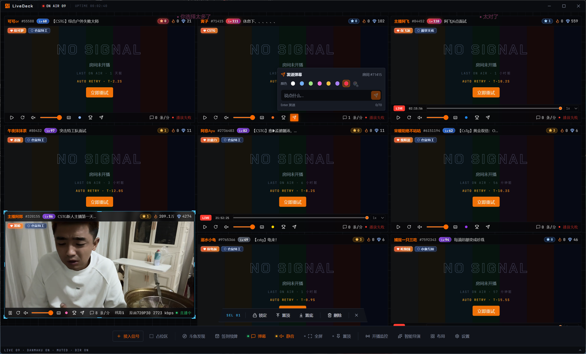

# LiveDeck

> 多路直播同时观看的桌面工作台

LiveDeck 让你在一块屏幕上同时看多个斗鱼、虎牙与哔哩哔哩直播间，不同平台的房间可以
混排在同一个布局里。窗口可以像在 OBS 里摆场景一样自由
拖动缩放，所有房间的弹幕汇进同一个引擎全屏滚动，不必再挤在每个小窗口自己的弹幕栏里。

适合同时追多个主播、看比赛多视角、或者一边玩游戏一边挂着直播的场景。

## 功能特性

### 多窗口与布局

- **任意数量的直播窗口**，每个窗口独立控制音量、清晰度、线路与弹幕开关
- **完全自由的拖动布局**，八向缩放，边缘与窗口间自动吸附并显示参考线，按住 `Alt`
  临时禁用吸附
- **预设排列**：平铺、主次、横排、竖排，一键把当前所有窗口排好
- **布局方案存储**，命名保存多套布局随时切换，适配不同观看场景，支持导出导入
- **占位模式**：用占位符占住游戏窗口的位置，方便单屏用户一边玩游戏一边看直播，
  占位符参与布局但不播放内容
- 窗口支持锁定防误拖、置顶置底调整叠放次序、多选与框选

### 直播播放

- **三平台直播**：斗鱼、虎牙、哔哩哔哩，输入房间号、链接或分享文本自动识别平台并取流，
  HLS / FLV 自动适配，**默认最高清晰度**
- **自由切换清晰度与线路**，遇到某条线路卡顿可以换一条
- **兼容回放模式**，支持回放的直播间可用进度条拖动观看
- **回看弹幕补全**：回看时自动接入斗鱼官方弹幕归档，应用没开着的时段也有弹幕
- 取流失败、地址过期、画面停滞均自动重试，退避上限 5 秒且不限次数
- **丰富的房间信息**：标题、主播昵称与等级、热度、贵宾数、福星挑战赛区、清晰度、
  码率、弹幕速率，以及房间各类排行榜
- **音频 SOLO**：一键只听某个房间，其余全部静音；普通模式下也可单独开关任意房间声音
- **录像与视频**：浏览斗鱼、虎牙录像与哔哩哔哩视频（含分 P），可直接加入布局与直播并排观看
- **PK 与连麦**（斗鱼）：底部比分条实时显示双方比分、连麦成员，可一键打开对方房间
- **播放调试面板**：右键窗口打开，查看下载速率、缓冲与帧率曲线，可复制脱敏报告用于反馈

### 弹幕

- **全局弹幕模式**：融合显示所有已开窗直播间的弹幕，以弹幕前的**颜色指示点**区分来源
  房间 —— 解决多窗口时每个窗口弹幕区太窄的问题
- **高性能渲染**：可选 WebGL 纹理批渲染模式，同屏上万条弹幕仍保持稳定高帧率
  （实际取决于显卡）；WebGL 不可用时自动回退到兼容模式
- 还原弹幕颜色、用户等级、粉丝牌与表情，轨道自动防重叠，超载限流
- **弹幕消息卡**：按住 `Alt` 单击弹幕，查看发言者头像与资料，可引用或 +1
- **消息与事件时间线**：按时间回溯各房间的弹幕、礼物、进场等事件
- **特别关注**：关注特定用户，其进房、发言、送礼会突出显示，并可设置绕过全部过滤规则；
  关注动态记录这些用户的行为，统计表支持搜索、排序与筛选
- **屏蔽策略**：关键词、正则、用户名、用户等级、弹幕长度
- **其他房间事件**：礼物、高能弹幕、进场、开通会员，按平台分别设置开关
- **逐窗弹幕开关**：单个窗口可单独关闭弹幕显示。关闭只停止渲染，**不断开连接** ——
  事件提醒、关注用户通知、房间榜单与弹幕速率统计照常工作

### 斗鱼鱼吧

- **浏览鱼吧**：控制台入口打开右侧抽屉，自动从当前房间发现主播鱼吧，也可直接输入鱼吧 ID
  或地址；未登录可匿名浏览动态、精华、相册、视频、主播动态及评论回复，图片与视频在应用内查看
- **鱼吧互动**（需登录）：签到、发动态、评论、回帖、点赞与表态。应用不会自动加入任何鱼吧，
  发帖等操作由服务端按加入状态与等级门槛校验

### 像素补给站

- 新手教学、日常任务、每周邀约与长线成就，跟着任务就能摸清各项功能
- 金币与经验只记录在本机，按真实观看与操作推进，不需要登录

### 开播监控与导演模式

- **开播监控**：把主播加入监控列表，**开播与下播时分别通过系统通知提醒**（两个开关
  独立），点击开播通知可直接开窗。托盘菜单显示当前在播数量
- **智能导演模式**：自动以高亮边框突出当前热度快速上涨的直播间，免得错过精彩时刻。
  评分权重（弹幕速率、贵宾数、热度、礼物）可自由配置，也可整体关闭。轮播与未开播的
  房间不参与判定，避免"有人在等"被误判成精彩

### 界面与设置

- 深色 / 浅色 / 跟随系统主题
- 有直播窗口时自动阻止系统休眠（可关闭），窗口可置顶
- 关闭按钮行为可选最小化到系统托盘或直接退出
- 窗口大小、位置、最大化与全屏状态自动记忆
- 新窗口的默认大小、音量、弹幕、画质策略，画面填充方式，角标位置与字号，顶部信息栏
  与状态栏字段，通知类型与后台规则，均可自定义
- 设置支持导出备份、导入恢复与重置默认值，重置不影响布局、监控列表与登录状态

## 需要登录才能使用的功能

不登录也能正常看直播和看弹幕。斗鱼、虎牙、哔哩哔哩各自独立登录，登录之后额外解锁：

- **发送弹幕**，并可选择账号权限内的弹幕颜色与粉丝牌（三平台）
- **同步关注列表与最近观看**，直接从列表挑房间开窗（三平台）
- **粉丝牌成长与任务详情**（三平台）

以下为斗鱼专属：

- **一键签到**：房间签到、客户端签到、鱼吧签到等
- **一键续牌**：给所有拥有粉丝牌的房间送出指定数量的荧光棒
- **鱼吧互动**：发动态、评论、回帖、点赞与表态

登录在各平台官方登录页面完成，账号密码不经过本程序，登录凭据只保存在本机。
登录状态下进房会正常计入贵宾榜。

> **关于一键签到的重要说明**
>
> 部分签到任务（如星推关注任务）需要**自动关注并浏览一些活动直播间**，签到完成后
> 程序会自动还原关注状态与观看历史记录。介意此行为请勿使用该功能。
>
> 此外，一键签到与一键续牌属于自动化批量操作，**可能与斗鱼用户协议相悖，存在账号
> 风险**，是否使用请自行判断。以第三方工具登录任何平台并发弹幕等互动，同样可能被平台
> 风控识别。详见 [免责声明](DISCLAIMER.md#三关于账号功能的重要风险提示)。

## 下载

前往 [Releases](https://github.com/0xyk3r/livedeck-release/releases/latest) 下载：

| 文件                               | 说明                                                       |
| ---------------------------------- | ---------------------------------------------------------- |
| `LiveDeck-<版本>-x64-Setup.exe`    | 安装版。装进系统，开始菜单与桌面有图标，推荐大多数人使用。 |
| `LiveDeck-<版本>-x64-Portable.exe` | 便携版。免安装双击即用，适合放 U 盘或不想改动系统。        |

需要 64 位 Windows 10（1809 及以上）或 Windows 11。暂无 macOS 与 Linux 版本。

大陆网络直连 GitHub 较慢，可使用加速地址，见 [安装说明](docs/install.md#下载)。

**Windows 会提示"未知发布者"**，这是正常的 —— 本程序未购买代码签名证书。点「更多
信息」→「仍要运行」即可。下载页为每个文件附了 SHA256 校验值，可自行核对，方法见
[安装说明](docs/install.md#核对-sha256)。

## 快速上手

1. 打开后点击右下角的圆形按钮展开菜单
2. 选「添加直播间」，先选平台，再输入房间号或直接粘贴链接（斗鱼靓号、B 站分享文本也可以）
3. 拖动窗口本体挪位置，拖边框改大小

想同时看几个就添加几个，布局会自动保存。

## 快捷键

| 按键                  | 作用                         |
| --------------------- | ---------------------------- |
| `F11`                 | 全屏 / 退出全屏              |
| `Esc`                 | 退出全屏；或取消当前选中     |
| `Tab` / `Shift+Tab`   | 循环切换窗口，选中的自动置顶 |
| `Ctrl+A`              | 全选窗口                     |
| `Ctrl` + 点击         | 多选窗口                     |
| `Delete` `Backspace`  | 删除选中的窗口               |
| 按住 `Alt` 拖动       | 临时关闭吸附，用于微调位置   |

## 更新与公告

程序会自动检查新版本与公告，有更新时在「设置 → 关于与更新」中提示，也可手动检查。

检查只请求一个很小的静态清单文件，不上传任何个人信息，可在设置中关闭。检测到新版本后可在
应用内直接下载更新包（加速镜像优先、GitHub 兜底，落盘后自动核对 SHA256），**程序不会自动
安装任何东西**，安装由你手动进行；也可以改用系统浏览器从下载页获取，页面列出全部镜像
与原始地址。

历史版本的更新内容见 [CHANGELOG.md](CHANGELOG.md)。

## 遇到问题

先看 [常见问题](docs/faq.md)。未能解决欢迎提
[Issue](https://github.com/0xyk3r/livedeck-release/issues)，请附上版本号、复现步骤，
以及日志文件（位置见 [常见问题](docs/faq.md#日志在哪)）。

## 声明

LiveDeck 是独立开发的第三方播放工具，**与斗鱼、虎牙、哔哩哔哩官方均无任何隶属、合作或授权关系**。

本程序不提供、不存储、不转码、不转发任何直播内容 —— 它只是把平台公开下发的流地址交给
本机播放组件播放。所有直播内容的版权归原平台与主播所有。程序依赖各平台的公开接口，对方
调整接口可能导致功能临时失效。

使用前请阅读 [免责声明](DISCLAIMER.md) 与 [许可条款](LICENSE)。

