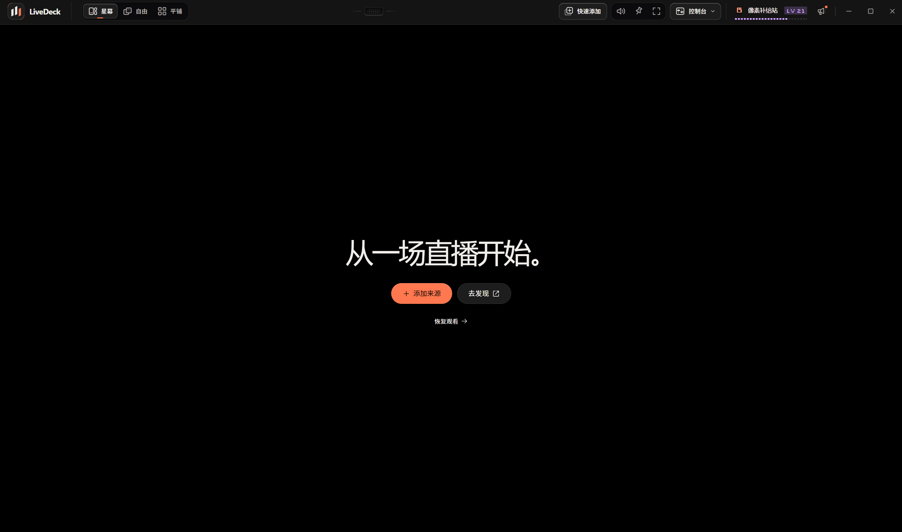

# LiveDeck

> 多路直播与视频同时观看的桌面工作台

在一块屏幕上同时观看斗鱼、虎牙和哔哩哔哩，把直播、录像与视频放进同一个布局。星幕自动编排多路画面，自由布局允许任意摆放，平铺布局适合手动分屏；各房间弹幕可以汇入全局弹幕，声音也能集中调节。

适合追多个主播、观看比赛多视角，或在游戏旁留出几路直播。

[下载安装](#下载) · [快速上手](#快速上手) · [常见问题](docs/faq.md) · [1.4.0 更新说明](CHANGELOG.md#140--2026-11-18)

*LiveDeck 1.4.0 实机主界面，展示添加来源与常用入口；截图由维护者手动采集于 2026-11-18。*

## 快速上手

1. 从 [Releases](https://github.com/0xyk3r/livedeck-release/releases/latest) 下载并运行安装版或便携版
2. 点击标题栏「快速添加」或按 `Ctrl+K`，输入主播名、房间号、链接或分享文本，再选择来源；空舞台也可点击「添加来源」
3. 在标题栏选择星幕、自由或平铺；窗口较窄时从「控制台 → 布局」切换。星幕会自动编排；点击画面侧边的重点按钮可放大一路或多路，`Shift` 点击只聚焦这一路
4. 点击标题栏「控制台」打开发现、布局、音量与混音、开播监控及工具。想浏览直播、视频或录像，从「发现」选择平台与内容类型

首次使用默认星幕，已有布局继续恢复保存的模式。当前布局自动保存，也可以命名保存成多套方案。

应用全屏时，将鼠标移到右上角唤出控制台入口，或按反引号／波浪键开合；`F11` 退出全屏。完整快捷键见[下表](#快捷键)。

## 功能特性

### 多窗口与布局

| 模式 | 主要操作 | 适合的场景 |
| --- | --- | --- |
| 星幕 | 自动编排，选择多个重点，拖拽交换，固定格位，预览构图 | 多路观看、比赛多视角、快速聚焦 |
| 自由 | 拖动、八向缩放、重叠摆放、吸附对齐、调整层序 | 自定义构图、画中画、预留游戏区域 |
| 平铺 | 拖动分隔线、切分窗格、交换来源、临时全屏 | 手动分屏、需要画面铺满舞台 |

- **星幕巡看**：按住 `Z` 临时放大，滚轮切换画面；查看期间按住 `A` 临时独听，松开恢复。聚焦画面本身不会改变声音
- **快速版式**：自由和平铺提供均分网格、主副右栏和主副下栏；自由布局另有画中画。先预览，再确认应用
- **撤销与重做**：拖动、缩放、排列、关闭窗口等布局操作可撤销
- **保存与备份**：命名保存多套布局，支持导入导出；观看组可一键打开一组直播间
- **占位区**：为游戏或其他桌面窗口预留位置，参与布局但不播放内容
- 支持多选、框选和窗口锁定；星幕中的「固定格位」保留容器，画面仍可交换

### 发现与播放

| 平台 | 内容与特色入口 |
| --- | --- |
| 斗鱼 | 直播、官方录像、直播回看与归档弹幕、团播活动、PK 与连麦、鱼吧 |
| 虎牙 | 直播、官方录像、赛事赛程与主／二路、有效选手 POV、已授权直播回看、可用 HEVC／HDR 画质 |
| 哔哩哔哩 | 直播、视频关键词搜索、BV／AV 与分享链接、分 P、章节、平台字幕、部分主播公开直播回放 |

各项内容、画质与回看入口以平台实际开放和当前账号权限为准。公开视频回放不代表所有直播都有录像，赛事也不一定提供 POV 或回看。

- **快速添加**：连续选择监控主播，或查找新来源；已打开的来源可直接定位
- **发现直播**：按平台浏览分类、搜索、关注与最近访问；记住上次的平台、内容类型与筛选选择
- **逐路控制**：独立调整音量、清晰度、线路和弹幕。直播异常时会尝试自动恢复，持续失败可手动重试、换线或降低清晰度
- **多路对齐**：从播放器「更多控制 → 时间微调与多路对齐」调整 0–30 秒附加延迟，或用共同声音、画面时钟对齐不同视角；画面与声音一起调整，弹幕保持实时
- **独听与混音**：独听一次只听一路；要同时听几路，退出独听，在「音量与混音」分别设置各路的静音和音量
- **房间信息与诊断**：查看平台提供的主播、热度、贵宾、榜单和播放信息；右键打开调试信息，可复制脱敏报告用于反馈

### 弹幕、消息与关注

- **全局弹幕**：融合各窗口的弹幕，用颜色指示点区分来源；支持兼容与 WebGL 渲染，轨道防重叠和超载限流
- **身份与表情**：显示平台提供的用户等级、粉丝牌、权益色和表情；本人弹幕带有专属标记，斗鱼神秘人保留匿名身份
- **消息卡**：按住 `Alt` 单击画面上的直播弹幕，查看资料、复制、引用或 +1
- **消息时间线**：查阅本次运行收到的直播弹幕、礼物与进场等事件，支持搜索、筛选和定位来源
- **特别关注与关注动态**：按平台 UID 或昵称关注用户，突出显示其行为并查看记录；开播监控用于关注主播是否开播
- **过滤与房间事件**：关键词（含正则）与长度过滤对各平台通用；昵称、UID、等级过滤和房间事件提示按平台设置。高能弹幕、上头条与 SC 可设置金额门槛，选择精简展示或跟随平台时长
- 关闭单个窗口的弹幕显示后，房间事件、关注通知、榜单和弹幕速率仍可工作

### 字幕、画面与声音

| 功能 | 入口 | 范围与限制 |
| --- | --- | --- |
| 实时字幕与翻译 BETA | 播放器语言图标；设置 → 实时字幕 | 每次最多一路；原文、译文或双语，可优先使用视频已有字幕 |
| 插帧 BETA | 更多控制 → 画面插帧；设置 → 画面增强 | 最多两路；NVIDIA VFX、AMD AMF、通用 GPU，适用于可采样的 15–60 fps SDR 内容 |
| 超分辨率 BETA | 更多控制 → 超分辨率；设置 → 画面增强 | 最多一路；可单独使用，或与两倍、最高 120 fps 插帧组合 |
| 音频增强 BETA | 更多控制 → 音频增强；设置 → 音频增强 | 按播放器开启，对白增强、背景降噪、夜间模式、场景预设与原声对比 |
| 多路响度平衡 | 控制台 → 音量与混音；设置 → 音频增强 | 校准各路常态音量，支持逐路微调与重新校准 |

**字幕的数据使用**：本地模式在本机识别语音，翻译时向 Index-Translate 发送字幕文字；Echo 在线模式上传播放器音频，即使只显示原文也需要在线识别。两种模式都不使用麦克风，本地模式需要主动下载语音模型与 CPU 引擎。详见[字幕模式与数据使用](docs/faq.md#实时字幕有哪些模式会上传什么)。

**画面增强的设备要求**：NVIDIA 原生方式需要安装可选 VFX 组件并检查兼容性；AMD 依赖驱动能力，通用 GPU 需要硬件加速。VFX 与通用 GPU 插帧支持 2／4／8 倍或指定帧率，AMD 仅支持两倍。8 倍为实验性选项，最高 480 fps 是配置目标；实际表现取决于设备与来源。HDR、倍速、系统原生画中画使用原视频。详见[画面增强](docs/faq.md#画面增强)。

声音增强与响度分析在本机完成，不上传音频，不使用麦克风。响度平衡调整不同主播的常态音量，夜间模式减小同一路节目的音量起伏；两者用途不同。详见[声音与对齐](docs/faq.md#声音与对齐)。

### 账号与粉丝牌

不登录也能观看公开直播和弹幕。斗鱼、虎牙、哔哩哔哩分别登录后，可使用相应账号已有的权限：

- 发送弹幕、使用已解锁的颜色和表情、佩戴粉丝牌
- 浏览我的关注与直播最近访问，执行站内关注或取关
- 从「控制台 → 工具 → 粉丝牌总览」查找粉丝牌，查看平台提供的成长与任务信息
- 虎牙粉丝牌可主动手动打卡，完成状态以平台回执为准

斗鱼另提供一键签到、一键续牌、背包荧光棒赠礼，以及单房间和批量弹幕任务。签到默认开启「静默模式」，跳过尚未完成的活动弹幕任务；需要执行时，先关闭静默模式再开始签到。赠送荧光棒会消耗背包道具。

登录在平台官方页面完成。登录凭据保存在本机，并用于向对应平台认证；不会提交给开发者或无关服务。

> 一键签到、一键续牌与批量弹幕任务属于账号自动化操作，可能违反平台规则或触发风控。部分签到任务会临时关注并浏览活动房间，完成后尝试恢复；批量弹幕任务覆盖总览已加载的全部斗鱼粉丝牌房间，不受筛选和分页限制。使用前请阅读[账号功能风险说明](DISCLAIMER.md#三关于账号功能的重要风险提示)。

### 斗鱼鱼吧

从「控制台 → 工具 → 斗鱼鱼吧」打开，支持随看与展开阅读，在应用内查看帖子、文章、图片、视频、话题及评论回复。

- 未登录可浏览公开内容、热门推荐与近 7 天热度排行榜
- 登录后可查看已加入鱼吧、我关注的动态、收藏和赞过的内容
- 可主动签到、发布纯文字动态、评论、回复、点赞、表态和收藏

发帖与互动权限由鱼吧成员状态、等级及平台规则决定；使用说明见[鱼吧常见问题](docs/faq.md#斗鱼鱼吧)。

### 监控、成长与设置

- **开播监控**：分别设置开播与下播系统通知，点击开播通知可直接开窗；托盘菜单显示当前在播数量
- **智能导演**：根据弹幕、贵宾、热度与礼物变化突出显示活跃画面，评分权重可调整；轮播和未开播房间不参与
- **像素补给站**：新手课程、日常任务、每周邀约与成就；课程支持续学，功能指南涵盖字幕、画面和声音增强。金币与经验记录在本机
- **主题与观看舒适度**：墨黑、瓷白、自定义舞台背景；OLED 防烧屏可减轻固定画面的持续显示负担，不能保证避免烧屏
- **桌面操作**：总音量、快捷静音、置顶、全屏、托盘、关闭按钮行为和阻止系统休眠
- **设置备份**：导出、导入与恢复默认；新窗口、画质、画面适配、角标、房间事件和通知均可配置

## 快捷键

下表中的布局快捷键用于舞台操作；输入框或其他面板取得焦点时，优先处理当前输入与面板操作。

| 按键 | 作用 |
| --- | --- |
| `F11` | 应用全屏／退出全屏 |
| `Esc` | 关闭当前浮层、取消调整或结束临时查看；星幕返回总览；退出全屏 |
| `Ctrl+K` | 打开／关闭快速添加 |
| 反引号／波浪键 | 打开／关闭控制台 |
| `Alt+T` | 循环切换星幕／自由／平铺 |
| 方向键 | 舞台导航时选择窗口；自由布局中选中的窗口同时置顶 |
| `Ctrl+A` | 全选窗口 |
| `Ctrl` + 点击 | 多选窗口 |
| `Delete`／`Backspace` | 删除选中的窗口 |
| 按住 `Alt` 拖动 | 自由布局中临时关闭吸附 |
| `Ctrl+Z` | 撤销布局操作 |
| `Ctrl+Y`／`Ctrl+Shift+Z` | 重做 |
| `Enter`／`Shift+Enter` | 星幕中加入或取消重点／仅聚焦当前画面 |
| 按住 `Z`，滚动滚轮 | 星幕中临时放大并巡看 |
| 临时查看时按住 `A` | 临时独听当前画面，松开恢复 |
| `Alt` + 方向键 | 平铺中焦点移到相邻窗格 |
| `Alt+Shift` + 方向键 | 平铺中与相邻窗格交换 |
| `Alt+Enter` | 平铺中临时全屏当前窗格 |
| `Alt+D`／`Alt+S` | 平铺中左右／上下切分 |
| 按住 `Alt` 单击直播弹幕 | 打开弹幕消息卡 |
| `空格`／`K` | 录像／视频播放或暂停 |
| `←`／`→` | 录像／视频快退或快进 5 秒，加 `Shift` 为 30 秒 |

## 下载

前往 [Releases](https://github.com/0xyk3r/livedeck-release/releases/latest) 下载。需要 64 位 Windows 10（1809 及以上）或 Windows 11；目前没有 32 位、ARM、macOS 或 Linux 安装包。

| 文件 | 说明 |
| --- | --- |
| `LiveDeck-<版本>-x64-Setup.exe` | 安装版，可选安装位置，适合常用电脑 |
| `LiveDeck-<版本>-x64-Portable.exe` | 便携版，免安装，布局、设置和登录状态保存在 exe 同级的 `LiveDeckData` |

基础观看无需额外组件。字幕模型、引擎和可选 VFX 组件由你按需下载；升级、加速下载、SHA256 核对和 Windows 提示的处理方法见[安装说明](docs/install.md)。

## 更新与公告

在「设置 → 关于与更新 → 更新与公告」自动或手动检查新版本，标题栏公告入口可查看未读公告。可以关闭自动检查。

检测到新版后，可主动下载更新包，程序会校验 SHA256；安装由你手动进行。也可在系统浏览器打开下载页选择来源。历史变化和升级时需要留意的操作调整见[更新历史](CHANGELOG.md)。

## 遇到问题

先看[常见问题](docs/faq.md)。仍未解决时，请向 [Issues](https://github.com/0xyk3r/livedeck-release/issues) 提供版本号、复现步骤和相关日志；播放问题可附脱敏调试报告，日志位置见[这里](docs/faq.md#日志在哪)。

## 声明

LiveDeck 是独立开发的第三方播放工具，与斗鱼、虎牙、哔哩哔哩官方均无隶属、合作或授权关系，不提供直播内容托管、录制保存、转码或转播服务。

内容版权归原权利人所有。平台与字幕服务的接口、权限和可用性可能变化；使用前请阅读[免责声明](DISCLAIMER.md)与[许可条款](LICENSE)。
